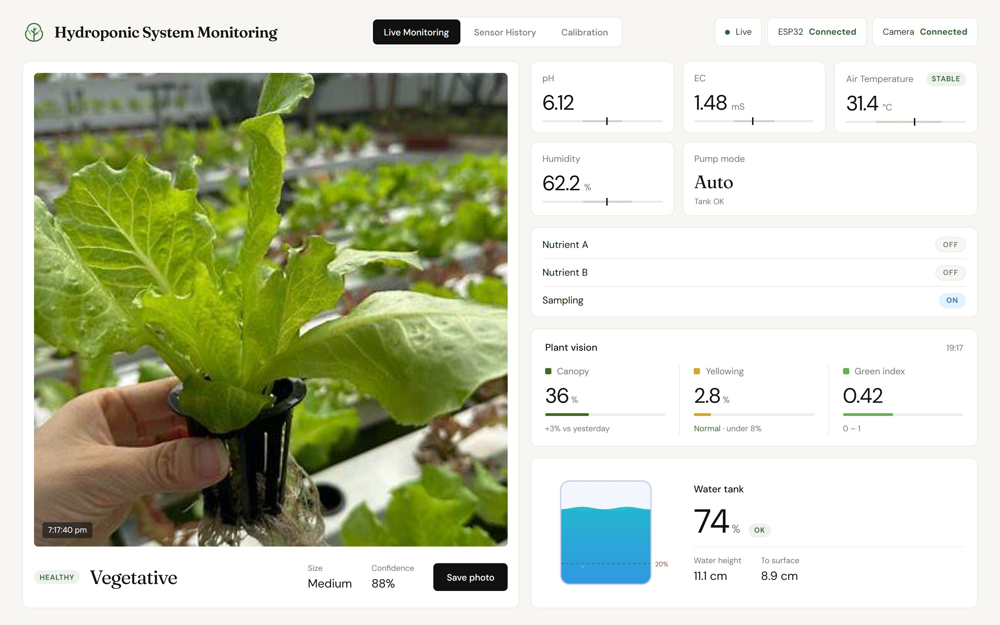
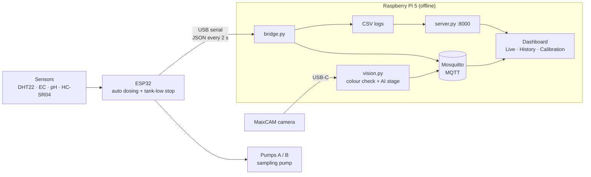

# Indoor Vertical Garden Monitoring & Automation System

A hydroponic lettuce (*Lactuca sativa*) system that **measures its own water and air, doses
nutrients by itself, watches the plants with a camera, and shows everything on an offline
dashboard**. Built for **Innovation 2026** by the **UniKL MFI Robotic Society**.


<sub>Live Monitoring tab (screenshot with simulated sensor data).</sub>

---

## Why

Lettuce grows best when the nutrient water stays at **EC 1.2–1.8 mS/cm** and **pH 5.5–6.5**, but
both drift every day. Checking by hand is slow, problems at night are found the next morning,
pumps can run dry, and plant health is judged by eye. This system checks and corrects itself
around the clock, without needing the internet.

## What it does

- **Senses** air temperature, humidity, EC, pH and tank water level every 2 seconds
- **Doses nutrients automatically**: Pump A and Pump B run until EC and pH are back in range
- **Protects the pumps**: everything stops when the tank drops below 20 %
- **Watches the plants**: a camera checks leaf colour and an AI model (MobileNetV3) tells the
  growth stage: seedling, vegetative or matured (**86 % test accuracy**, 10 ms per photo on the Pi 5)
- **Logs everything** to CSV and shows live values, 1 h / 24 h / 7 day history and guided
  calibration on a web dashboard, full screen on an HDMI monitor at boot
- **Runs fully offline**: USB cable, local MQTT broker, no cloud

## How it works



The ESP32 is the only part that touches the hardware, so dosing and pump protection keep working
even if the Pi is off. The Pi adds memory (logs), eyes (camera + AI) and a screen (dashboard).

| Part | Role |
|---|---|
| ESP32 Dev Module | Reads sensors, controls 3 pumps through 2 relay modules |
| DHT22 · EC V2.1 · PH-4502C · HC-SR04 | Air temp/humidity · nutrient strength · pH · water level |
| Raspberry Pi 5 | MQTT broker, logging, camera AI, dashboard |
| Sipeed MaixCAM | Plant camera |

## Documentation

All details live in [`docs/pdf/`](docs/pdf/):

| Document | Contents |
|---|---|
| [01 Introduction](docs/pdf/01_Introduction.pdf) | Problem, objectives, scope, components, features, status |
| [02 ESP32 Pin Configuration](docs/pdf/02_ESP32_Pin_Configuration.pdf) | Pinout, wiring table, voltage dividers, power rails |
| [03 Dataset](docs/pdf/03_Dataset.pdf) | Lettuce growth-stage photos, model training and results, data logs |
| [04 System Diagram & Flowchart](docs/pdf/04_System_Diagram_and_Flowchart.pdf) | Architecture, MQTT topics, firmware and pump flowcharts |
| [05 Dashboard Overview](docs/pdf/05_Dashboard_Overview.pdf) | Tour of the three dashboard tabs |
| [Hydro System Guide](docs/pdf/Hydro_System_Guide.pdf) | **Full technical guide**: setup, running, calibration, commands, troubleshooting |
| [EC Sensor Guide](docs/pdf/EC_Sensor_Guide.pdf) | How the EC sensor works and how to calibrate it |
| [Project paper](docs/pdf/innovation_fard.pdf) | Innovation 2026 write-up |

## Quick start

1. **ESP32:** open `firmware/Full_code/Full_code.ino` in the Arduino IDE (board *ESP32 Dev
   Module*, libraries *DHT sensor library* + *Adafruit Unified Sensor*) and upload.
2. **Raspberry Pi 5:** clone this repo to `~/hydro`, then install Mosquitto, the udev rule and the
   services in `backend/` (step by step in the
   [System Guide](docs/pdf/Hydro_System_Guide.pdf), section 5).
3. **Run:** plug the ESP32 into the Pi. The bridge starts by itself; open
   **http://localhost:8000** (or `http://<pi-ip>:8000` from a phone on the same network).
4. **Calibrate** EC, pH and tank level from the dashboard's *Calibration* tab.

## Repository

```
firmware/        ESP32 sketches (Full_code = main firmware, plus single-sensor tests)
backend/         Pi side: bridge.py, vision.py, server.py, AI model, training, services
frontend/        Dashboard web page (works offline)
maixcam/         Camera app that runs on the MaixCAM
dataset/         88 lettuce photos by growth stage (+ 224×224 version)
Circuit Diagram/ Wiring diagram (EasyEDA project)
docs/            PDFs (docs/pdf) and the scripts that build them
```

## Status

**Working:** sensing, automatic dosing, tank-low protection, logging, camera health check,
growth-stage AI, dashboard and HDMI kiosk.

**Next:** retrain the AI with photos from the system's own camera · MQTT password ·
water-temperature sensor (DS18B20) for EC compensation · grow-light relay · RTC battery for
offline timestamps.

> The dataset photos were collected from the internet for this student project and are used
> for training and evaluation only.
